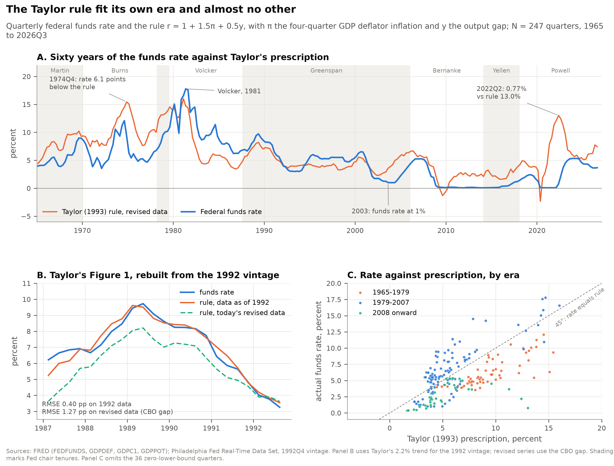
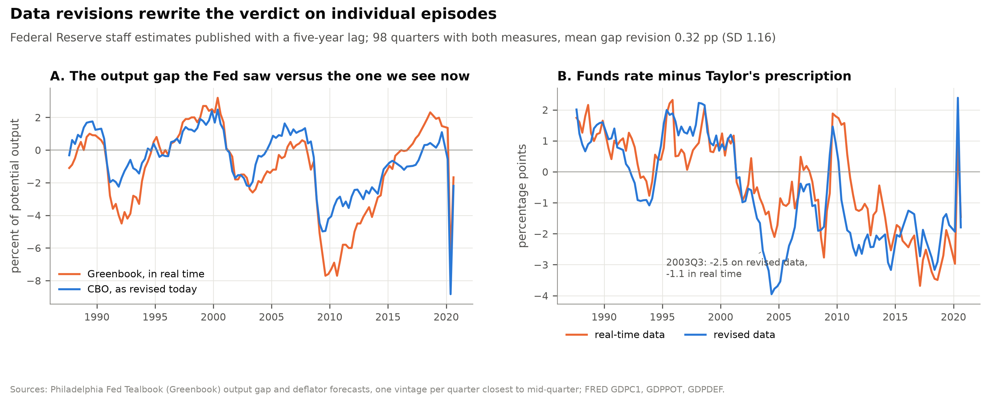
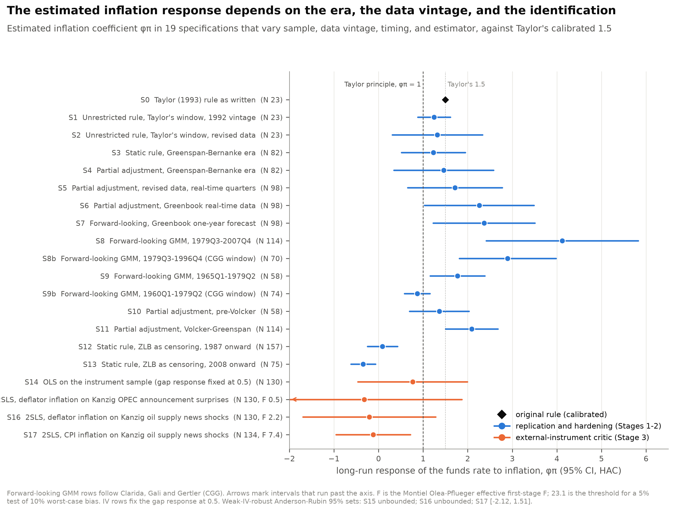
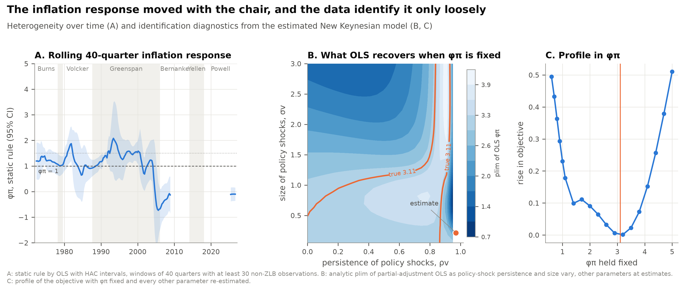
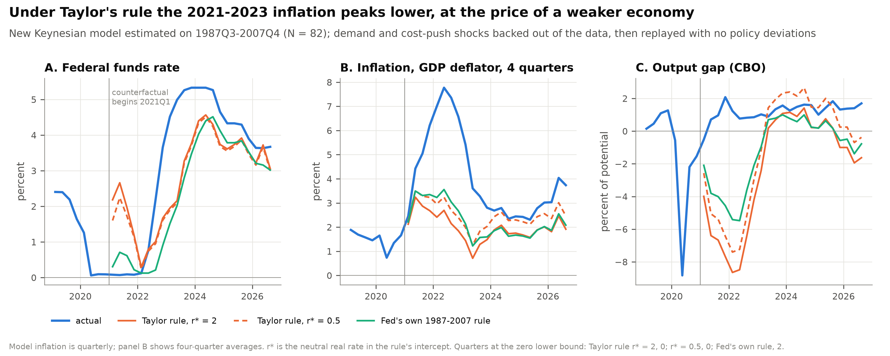

# The Taylor Rule Fit Its Own Era

*John B. Taylor (1993) asked whether a two-term formula could describe how the Federal Reserve sets interest rates. I rebuilt his rule from the data he had in 1992 and tested it against sixty years of revised data, the Fed staff's own real-time forecasts, an external instrument, and an estimated New Keynesian model.*

---

In the second quarter of 2022, prices across the American economy were rising at 7.8 percent a year, measured by the GDP deflator. The Federal Reserve under Jerome Powell held the federal funds rate at an average of 0.77 percent that quarter, which put the real policy rate near minus 7.0 percent. A formula published by the Stanford economist John Taylor three decades earlier, fed the same inflation number and the Congressional Budget Office's estimate of the output gap, prescribes a funds rate of 13.0 percent. The gap between what the Fed did and what the formula says, 12.3 percentage points, is the largest in the sixty years of data I assembled, larger than any quarter under Arthur Burns in the 1970s.

That number is the reason the Taylor rule is back in arguments about the Fed. Politicians cite it when they want the central bank on a leash, and Fed officials cite it when they want to show they are not improvising. Both uses rest on a claim Taylor made in 1993, that a simple rule "fits the actual policy performance during the last few years remarkably well." This repository asks how far that claim travels. It rebuilds Taylor's evidence exactly, then pushes the rule through every test the later literature threw at it, and finally asks what would have happened in 2021 if the Fed had followed it.

---

## The formula

Taylor's rule sets the policy rate from two numbers the Fed can observe each quarter, inflation over the past year and the percentage gap between real GDP and its trend. In his notation, with r the funds rate, p inflation, and y the output gap, all in percent:

> r = p + 0.5y + 0.5(p − 2) + 2

The 2 inside the parentheses is an inflation target of 2 percent. The final 2 is the real interest rate Taylor considered neutral. Collecting terms gives the form that is easier to compute, r = 1 + 1.5p + 0.5y. Every extra point of inflation raises the prescribed rate by 1.5 points, so the real rate rises when inflation rises. That feature, a response larger than one, later became known as the Taylor principle.

Take the last quarter in Taylor's paper, the third quarter of 1992, using the data that existed when he wrote. The 1992 vintage of the Commerce Department's accounts, preserved in the Philadelphia Fed's Real-Time Data Set, put four-quarter GDP deflator inflation at 2.48 percent and real GDP 2.36 percent below Taylor's 2.2 percent trend. The rule gives 1 + 1.5 × 2.48 + 0.5 × (−2.36) = 1 + 3.72 − 1.18 = 3.54 percent. The actual funds rate that quarter averaged 3.26 percent. Alan Greenspan's Fed was within 0.28 points of the formula.

Now take 2022Q2 with today's data. Inflation was 7.77 percent and the CBO gap was 0.77 percent. The rule gives 1 + 1.5 × 7.77 + 0.5 × 0.77 = 1 + 11.65 + 0.38 = 13.03 percent, against an actual rate of 0.77 percent.

Across all 211 quarters from 1965 to 2026 when the funds rate was above zero, the distribution of the gap between the actual rate and the rule looks like this:

| Position in the distribution | Rate minus rule (points) | Quarter | Fed chair |
|---|---|---|---|
| Bottom decile (policy looser than the rule) | −3.77 | 2026Q3 | Powell |
| Median | −0.95 | 2002Q1 | Greenspan |
| Top decile (policy tighter than the rule) | 2.42 | 1985Q3 | Volcker |
| Most extreme loose quarter | −12.26 | 2022Q2 | Powell |
| Most extreme tight quarter | 6.66 | 1982Q2 | Volcker |

The median quarter sits about a point below the rule. Three chairs own the tails, with Volcker above the rule and Burns and Powell below it.

---

## Taylor's paper and the argument it started

Taylor wrote "Discretion versus Policy Rules in Practice" for the Carnegie-Rochester conference series, and most of the paper is about something else, the practical problem of moving from one policy regime to another. The rule appears on page 202 as an illustration of what a decade of model-based research on policy rules recommended. Taylor chose round coefficients "that make for easy discussion" and then noticed that the formula tracked the Fed's actual decisions from 1987 to 1992. His Figure 1 has been redrawn in papers and central bank speeches ever since.

The idea spread because it did two jobs at once. For central bankers it offered a benchmark that was simple enough to explain to a legislature. For academics it offered a way to summarize a central bank's behavior with two numbers that could be estimated and compared across eras. Richard Clarida, Jordi Galí, and Mark Gertler used exactly that move in a celebrated paper. They estimated a forward-looking version and found that the Fed's response to expected inflation was below one before Paul Volcker and well above one after. In their reading the inflation of the 1970s happened because the pre-Volcker rule left room for self-fulfilling swings in inflation expectations. In the working-paper version of their Table 2 the coefficients are 0.80 and 1.96.

Two critiques followed, and both are strong. Athanasios Orphanides, then a Fed economist, pointed out that every estimate used revised data the Fed never saw. Output gaps in particular are rewritten years after the fact. When he reran the regressions on the staff's real-time Greenbook numbers, the estimated responses of simple rules changed materially, and in later work he argued that the Fed of the 1970s looks far less negligent once its real-time view of the output gap is taken into account. The second critique is more fundamental. John Cochrane showed that in the New Keynesian model that gives the Taylor principle its meaning, the coefficient that matters for stability is not identified by the regression everyone runs. The regression recovers some mixture of policy and the persistence of shocks. On this view, a decade of papers that "estimated" the Taylor principle measured something else.

Defenders of the rule have good answers to both. Real-time data can be used directly, and they are now public. And identification problems are a reason to look for better instruments, not to stop measuring. I take both sides seriously below.

---

## How I built the test

All data are public and downloaded by `src/01_data_pipeline.py`, with a SHA-256 hash for every file. The quarterly panel runs from 1959Q1 to 2026Q3. The funds rate, GDP, the GDP deflator, CBO potential output, CPI and core PCE come from FRED. The 1992 vintage of GDP and the deflator comes from the Philadelphia Fed's Real-Time Data Set. The Fed staff's real-time output gap and deflator forecasts come from the Philadelphia Fed's Tealbook (Greenbook) archive, which the Board releases with a five-year lag, so they stop in 2020. Diego Känzig's series of oil supply surprises around OPEC announcements supplies an external instrument.

A simple regression of the funds rate on inflation and the output gap can be fooled in at least four ways, and each stage of the test addresses one of them. Stage 1 replicates Taylor's figure on the exact data vintage he used, then on today's data, which shows how much of the fit depends on data revisions. Stage 2 adds the refinements the literature introduced, including interest-rate smoothing, the Fed's real-time information, forward-looking expectations estimated by GMM in the manner of Clarida, Galí and Gertler, and the zero lower bound treated as censoring. Stage 3 confronts the identification critique head on. It instruments inflation with oil supply news, which moves prices for reasons unrelated to the Fed's own shocks, and it estimates a three-equation New Keynesian model in which the true response to inflation is a parameter rather than a regression coefficient. Stage 4 checks the estimators themselves with a Monte Carlo study calibrated to the estimated model, a structural break test, and influence diagnostics that drop one Fed chair or one year at a time.

Every number in this essay is written by the code into `results/key_numbers.json` or a results table, and an audit script checks the prose against those files before anything is published.

---

## On the data Taylor had, the rule fits to within 0.40 points

On the 1992 vintage, Taylor's rule tracks the actual funds rate across his 23 quarters with a root mean squared error of 0.40 percentage points and a correlation of 0.975. The largest miss is the first quarter of 1987, before Greenspan took office. That is an exceptionally good fit for a formula with no estimated parameters.

The same rule on today's revised data fits much worse. With the CBO output gap the error rises to 1.27 points, about 3.2 times larger, and the rule sits above the actual rate on average by 1.06 points. The difference is almost entirely the output gap. In 1992Q3, the data of the day showed GDP 2.36 percent below trend. Today's CBO series puts the same quarter 0.97 percent below potential, and a 2.2 percent trend drawn through today's GDP data puts it 2.02 percent above. Thirty years of benchmark revisions moved the economy of late 1992 from well below capacity to near or above it, depending on the measure.

Panel B of Figure 1 rebuilds Taylor's chart from the vintage data and overlays the rule computed from revised data. The rebuilt orange line lies on top of the funds rate, and the revised line drifts below it through 1988 and 1989. The fit Taylor reported was real, and it was also partly a product of the data available in 1992.

Estimated freely on the vintage data, the response to inflation is 1.25 with a standard error of 0.19 and the response to the gap is 0.55. Taylor's round numbers were close to what the Fed was doing. On revised data over the same quarters the inflation response is 1.32 with a standard error of 0.52, so the data no longer pin it down.

---

## The rule describes Greenspan and almost nobody else

Over the whole sample the rule is a poor description of policy. The table below summarizes each chair's tenure, using revised data and the CBO gap.

| Chair | Quarters | Mean inflation | Mean rate minus rule | RMSE of the gap | Share of quarters below the rule |
|---|---|---|---|---|---|
| Martin (from 1965) | 20 | 3.34 | −2.42 | 2.65 | 100% |
| Burns | 33 | 6.27 | −3.62 | 4.03 | 100% |
| Miller | 5 | 7.52 | −4.08 | 4.15 | 100% |
| Volcker | 32 | 5.35 | 2.72 | 3.50 | 12.5% |
| Greenspan | 74 | 2.42 | 0.13 | 1.63 | 37.8% |
| Bernanke | 32 | 1.90 | −1.37 | 1.75 | 87.5% |
| Yellen | 16 | 1.35 | −2.10 | 2.17 | 100% |
| Powell (to 2026Q3) | 35 | 3.27 | −3.52 | 5.03 | 97.1% |

Greenspan's average deviation is 0.13 points. Every other chair either ran policy consistently looser than the rule or, in Volcker's case, consistently tighter. A Quandt-Andrews test for a break in the rule's coefficients at an unknown date, run on 1965 to 2007, finds one at 1979Q4, the quarter of Volcker's October 1979 shift to reserve targeting. The test statistic is 64.3 against a simulated 5 percent critical value of 13.9. Rolling 40-quarter estimates of the inflation response swing from 2.08 in windows ending in 1993 to −0.73 in the window ending in 2005Q3.

The named extremes have institutional explanations. Burns's largest deviations, in 1974 and 1975, came during the OPEC embargo and its aftermath. In 1975Q1 inflation was running at 10.9 percent, the rule asked for 15.1 percent, and the funds rate averaged 6.3 percent. Burns argued that much of the inflation came from special factors such as oil and food prices, which he regarded as poorly suited to monetary remedies. Volcker's largest positive deviations, in 1982, are the cost of disinflation. The rule prescribed 7.9 percent in 1982Q2, and Volcker held rates at 14.5 percent to break expectations that the rule takes as given. Powell's 2021 and 2022 deviations reflect a forward-guidance commitment to keep rates at zero until the labor market had fully recovered, followed by a decision to treat the early inflation as transitory. At the end of 2021, with inflation at 6.2 percent, the funds rate was 0.08 percent.

The decomposition in `results/named_entities_table.csv` shows what drives the rule in each of these quarters. In 2022Q2 the inflation term alone, 1.5 times the excess of inflation over the 2 percent target, contributed 8.65 points. In 1975Q1 it contributed 13.39 points while a deep recession subtracted 2.32 through the gap term.

---

## Real-time data make the Fed look more aggressive, not less

For the Greenspan era, Orphanides's critique cuts in an unexpected direction. Between 1987Q3 and 2020Q1, the Fed staff's real-time output gap had a standard deviation of 1.80 percentage points. The CBO's revised gap for the same quarters has a standard deviation of 1.23. The revisions are strongly negatively correlated with the real-time estimate, at −0.74. In other words, the staff's gap swung too far in both directions, and later data pulled it back toward zero. That is the signature of measurement noise rather than news.

When the Fed's response is estimated on what the staff actually saw, the long-run response to inflation rises from 1.71 on revised data to 2.26 on real-time data, over the same 98 quarters, and the response to the gap falls from 2.14 to 1.38. Using the Greenbook's one-year-ahead inflation forecast instead gives 2.37. If the Fed set policy on its own staff's numbers, a regression on revised data should find an exaggerated response to the gap, because the revised gap moves less for the same policy action. The errors-in-variables formula derived in `TECHNICAL.md` predicts a revised-data gap response of 2.20 from the real-time estimates. The regression delivers 2.14. The same formula does not explain the inflation response (it predicts 0.96 against an actual 1.71), which suggests that revised inflation carries information the Fed was reacting to beyond the Greenbook's nowcast.

Real-time data also change the verdict on famous episodes. John Taylor himself argued at the Kansas City Fed's 2007 Jackson Hole symposium that the funds rate had been held well below his rule in 2003 to 2005 and that the shortfall fed the housing boom. On revised data the rule says the funds rate was 2.55 points too low in 2003Q3 and 3.95 points too low in 2004Q2. On the information the Fed had, the shortfalls are 1.07 and 1.82 points. The staff then saw inflation of 1.5 percent and a gap of minus 2.4 percent, both later revised up. The episode still shows policy below the rule, but by less than half as much.

---

## The coefficient everyone estimates is not the coefficient that matters

Versions of the regression in Figure 2 fill a large literature. Across 19 specifications that vary the sample, the data vintage, the timing and the estimator, the estimated inflation response ranges from −0.35 to 4.12. Only the three specifications built on the Volcker-Greenspan years reject a response of one or less after a Holm adjustment for multiple testing. On Clarida, Galí and Gertler's own windows, my GMM estimates are 0.87 for 1960 to 1979 and 2.90 for 1979 to 1996, against their 0.80 and 1.96. Starting the pre-Volcker sample in 1965 instead of 1960 raises the estimate to 1.77, so the famous sub-one coefficient leans on the early Martin years. After 2008, with the zero lower bound handled as censoring, the response is −0.35.

Cochrane's point explains why this regression is fragile. In the simplest version of the model, the real rate is constant, the Fed sets the rate as a multiple φ of inflation plus a persistent shock, and the only equilibrium that does not explode has inflation equal to the shock divided by (ρ − φ), where ρ is the shock's persistence. Plug that back in and the funds rate equals exactly ρ times inflation in every quarter, so a regression of the funds rate on inflation returns ρ, never φ. My simulation of this case, with φ set to 1.5 and to 3 and ρ set to 0.7, returns 0.70 both times, because the data reveal only the equilibrium relation between the rate and inflation and not the rule that produced it.

In the richer three-equation model I estimate on 1987Q3 to 2007Q4, by matching 21 autocovariances of the output gap, inflation and the funds rate, the structural response to inflation is 3.11 with a standard error of 1.58. The policy shocks in that model are extremely persistent, at the upper bound of 0.97 I allow, which means the model reads much of the smoothing in the funds rate as persistent deviations from the rule. The model's own fit barely discriminates among values of φπ. Holding φπ fixed anywhere from 0.6 to 5.0 and re-estimating everything else raises the estimation objective by at most 0.51, against a minimum of 0.80. Inside that estimated model, an ordinary least squares Taylor-rule regression converges to 1.26, and the partial-adjustment version converges to 1.66. A Monte Carlo study with 2,000 samples of 82 quarters drawn from the model confirms the analytic limits and shows the usual 95 percent intervals covering the true value in 11 percent and 50 percent of samples. If the model is right, the Taylor coefficients of about 1.5 found in Greenspan-era data are what a Fed with a response near 3 would produce.

The clean way out is an instrument that moves inflation for reasons the Fed's own shocks cannot explain. Oil supply news from OPEC meetings is a natural candidate. Its first-stage effective F statistic for four-quarter deflator inflation is 0.47 for the announcement surprises and 2.18 for Känzig's news shocks, far below the 23.1 threshold for reliable inference. The weak-instrument-robust Anderson-Rubin confidence sets are unbounded, which is the honest way of saying the instrument cannot settle the question. With CPI inflation, which moves more with oil, the effective F rises to 7.43 and the Anderson-Rubin set is [−2.12, 1.51]. That set excludes the strong responses in the Volcker-Greenspan OLS and GMM estimates. Read through economics rather than statistics, it says the Fed responded weakly to inflation that came from oil, which is what central banks say they do when they "look through" supply shocks. A single Taylor coefficient may be the wrong object, because the right response depends on where inflation comes from.

---

## Under Taylor's rule, the 2021 to 2023 inflation peaks lower and the economy pays for it

The estimated model can be used to replay recent history. For each quarter from 2018 onward I back out the demand, cost-push and policy shocks that reproduce the observed output gap, inflation and funds rate exactly. Then I rerun 2021Q1 onward with the same demand and cost-push shocks, no discretionary policy shocks, and the Fed following Taylor's 1993 rule. Expectations in the model adjust to the new rule, so the comparison is not a mechanical substitution of one interest rate path for another.

Under Taylor's rule with his 2 percent neutral real rate, the funds rate rises to 1.19 percent by 2021Q4, when the actual rate was 0.08 percent, and peaks at 4.56 percent in 2024Q2. Four-quarter inflation peaks at 3.2 percent instead of 7.8 percent, and quarterly inflation averages 2.0 percent over 2021 to 2023 against an actual 5.2 percent. The cost is large, with the output gap bottoming out at −8.6 percent in 2022Q1, and over 2021 to 2023 the economy gives up 16.2 percent of a year's potential output relative to what happened. The model reads the 2021 and 2022 boom as weak underlying demand propped up by deeply negative real rates, so a rule that raises real rates also withdraws the support that was holding output up.

The result depends on what one assumes about the neutral rate. With a neutral real rate of 0.5 percent instead of Taylor's 2, inflation over 2021 to 2023 averages 2.6 percent and the output gap bottoms out at −7.4 percent. If the Fed had followed its own estimated 1987 to 2007 rule with no deviations, inflation averages 2.5 percent, the gap bottoms out at −5.5 percent, and the zero lower bound binds in 2 quarters. All three paths keep average inflation within about half a point of the 2 percent target, and all three pass through a recession. In the model's reading, the Fed's 2021 and 2022 policy was far looser than any rule it had followed before, and following a rule would have traded roughly three points of average inflation for several points of lost output.

---

## Why it matters

For households, the 2021 to 2023 episode is the reason the rule matters. A rule-based Fed would most likely have held peak inflation several points lower. The model also says the price would have been a recession, so the choice the Fed faced was between a visible cost in jobs and a less visible cost in eroded real wages and savings. A rule makes that choice in advance and in public, which is its main virtue.

For workers, the gap term carries the most risk. The real-time output gap the Fed's staff saw swung by half again as much as the gap we now believe was there. A rule that leans hard on the gap transmits those measurement errors directly into interest rates, and the episodes where the Fed looked too loose or too tight often reflect what it knew at the time rather than what it wanted.

For investors and firms, the stable feature of the evidence is the regime break. Bond markets price the Fed's reaction function, and the data show that function changing sharply at 1979Q4 and again after 2008. An investor who treated any one era's coefficients as permanent would have mispriced the Volcker disinflation that began in 1979 and the delayed tightening of 2022.

For policymakers and legislators who want to write a rule into law, the identification result is the warning. The coefficient that determines whether a rule stabilizes inflation is not something the data reveal directly. A statute that hardwires 1.5 because that is what Greenspan-era regressions show could be enshrining a number that understates the response the Fed actually needed.

---

## Limits of this study

The analysis has clear boundaries. Real-time Greenbook data end in 2020 because of the five-year release lag, so the real-time tests cannot speak to the 2021 to 2023 episode. The external instrument is weak in every version I tried, and its exclusion restriction (that OPEC news reaches the funds rate only through inflation) is an assumption, not a fact; oil also moves output and financial conditions. The structural model has three equations, AR(1) shocks, no financial sector and no explicit forward guidance, and its estimated policy shocks sit at the persistence bound I imposed, which signals that the model attributes slow-moving changes in the neutral rate to policy. The counterfactual inherits all of that. Its Phillips curve is purely forward-looking, so inflation responds to a new rule at once, which probably overstates how quickly a rule would have brought inflation down, and it handles the zero lower bound with one-period surprises rather than a fully nonlinear solution. Finally, no amount of data can recover the off-equilibrium threat that gives the Taylor principle its force, which is Cochrane's point and remains the hard limit on what any regression in this repository can establish.

---

## Further reading and repository guide

- `TECHNICAL.md` contains the model, the propositions and proofs (including the identification and errors-in-variables results), the methodological audit of the original paper, full results tables, the Monte Carlo validation, design decisions, and the complete bibliography.
- `results/FINDINGS.md` is a one-page digest of the verdict and the main tables.
- `src/01_data_pipeline.py` through `src/05_audit.py` rebuild every number; `make all` runs the whole pipeline, and `make test` runs the unit tests.
- Taylor, J. B. (1993). "Discretion versus Policy Rules in Practice." *Carnegie-Rochester Conference Series on Public Policy* 39: 195–214. [doi:10.1016/0167-2231(93)90009-L](https://doi.org/10.1016/0167-2231(93)90009-L)
- Clarida, R., J. Galí and M. Gertler (2000). "Monetary Policy Rules and Macroeconomic Stability." *Quarterly Journal of Economics* 115(1): 147–180. [doi:10.1162/003355300554692](https://doi.org/10.1162/003355300554692)
- Orphanides, A. (2001). "Monetary Policy Rules Based on Real-Time Data." *American Economic Review* 91(4): 964–985. [doi:10.1257/aer.91.4.964](https://doi.org/10.1257/aer.91.4.964)
- Cochrane, J. H. (2011). "Determinacy and Identification with Taylor Rules." *Journal of Political Economy* 119(3): 565–615. [doi:10.1086/660817](https://doi.org/10.1086/660817)
- Känzig, D. R. (2021). "The Macroeconomic Effects of Oil Supply News." *American Economic Review* 111(4): 1092–1125. [doi:10.1257/aer.20190964](https://doi.org/10.1257/aer.20190964)
- Data: [FRED](https://fred.stlouisfed.org/) (FEDFUNDS, GDPC1, GDPDEF, GDPPOT, PCEPILFE, CPIAUCSL, UNRATE, NROU); [Philadelphia Fed Real-Time Data Set](https://www.philadelphiafed.org/surveys-and-data/real-time-data-research/real-time-data-set-for-macroeconomists); [Philadelphia Fed Tealbook (Greenbook) data](https://www.philadelphiafed.org/surveys-and-data/real-time-data-research/philadelphia-data-set) and [output gap set](https://www.philadelphiafed.org/surveys-and-data/real-time-data-research/gap-and-financial-data-set); [Känzig oil supply news series](https://github.com/dkaenzig/oilsupplynews).

Brendyn Beasley
